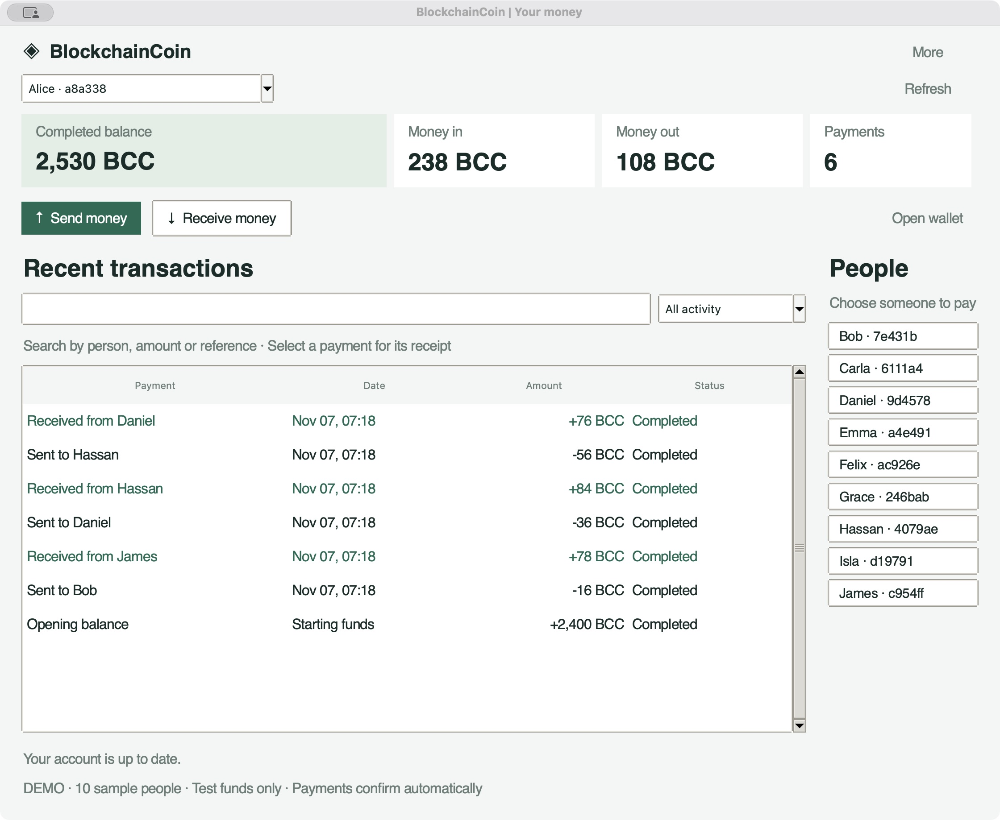

# BlockchainCoin

> **Project status: Codex experiment.** This was vibe-coded with Codex to explore
> blockchain mechanics. It is a learning exercise, not a flagship portfolio
> project or a production-ready system. The technical notes below describe
> the experiment; they are not independent validation of its guarantees.

BlockchainCoin is a technically complete academic release of a UTXO blockchain currency node written in Python. The project is intended for review, teaching, controlled experiments, reproducible builds, and research networks where the claims can be inspected directly in code, tests, and documentation.

The UTXO-native node is the only chain implementation in the package.

## Desktop preview

A native Python wallet with a compact account overview and transaction-focused
layout. Try payments between **10 synthetic people** with 30 completed sample
payments, named payees, searchable history, filters, and payment receipts.



[Payment review and receipt screenshots, simulation results, and reproduction steps](docs/desktop-demo.md).

The node ships with:

- A durable full-node substrate backed by SQLite WAL storage, schema versioning, cumulative work tracking, hostile-input validation, and a 100% coverage gate.
- A UTXO consensus-state module used as the consensus-critical core for research-network operation.
- A UTXO-native local node path backed by fork-aware storage and fork choice, with mempool admission checks, mining, import validation, reorg-capable active state selection, and state rebuild on restart.
- Persistent local mempool storage with restart pruning, operator inspection, clearing, and configurable admission policy limits.
- Durable chain-parameter records with chain-id derivation so reopened nodes reject mismatched consensus settings.
- Fork-aware consensus block storage that can retain competing branches and select the best tip by cumulative work.
- Fork-choice validation that rebuilds UTXO state for the selected active branch and rejects disconnected or consensus-invalid stored branches.
- Persistent UTXO indexing for the active tip, with replay fallback when the snapshot is missing or stale.
- Versioned peer message protocol with network magic, length-prefixed framing, inventory messages, transaction/block payloads, and malformed-frame rejection.
- Header-first peer sync messages with block locators and compact header responses for active-chain discovery before full block transfer.
- Header-chain validation for peer `headers` batches, including contiguous links, sequential heights, supported versions, and proof-of-work.
- Header-driven block download scheduling converts missing validated headers into `getdata` requests without re-requesting known blocks, and only for header batches anchored to a known block.
- In-flight block download tracking suppresses duplicate requests and clears work on timeout, peer disconnect, peer ban, or block arrival.
- Peer-selected block download routing can send `getdata` to the least-busy connected peer known to have advertised the needed header.
- Bounded block download batches split large missing-header runs into deterministic `getdata` chunks per selected peer.
- Expired block download retries reschedule bounded requests and prefer alternate known peers when possible.
- Per-peer in-flight block download caps prevent one source from being overloaded during multi-peer scheduling.
- Bounded peer inventory tracking limits long-lived session memory growth.
- Per-peer sync progress accounting tracks requested, completed, timed-out, and failed block downloads.
- SQLite-backed peer sync progress persistence keeps block download quality inputs across service restarts.
- Peer quality scoring uses persisted sync progress to prefer more reliable block download sources.
- Peer session state machine with version/verack handshake, ping/pong liveness, inventory request tracking, and reject/misbehavior accounting.
- Peer address manager with connection limits, retry backoff, bans, deterministic outbound selection, and eviction candidates.
- In-process node service wiring consensus, peer sessions, peer management, inventory relay, getdata responses, and misbehavior handling.
- TCP transport adapter and client using HMAC-authenticated peer frames and node service dispatch.
- TCP inbound peer admission goes through peer-manager connection limits before message dispatch.
- Ban-threshold peer eviction enforced through node service disconnect signals and TCP transport connection drops.
- Long-lived TCP peers receive transaction and block inventory fanout from other connected peers.
- Runtime facade for creating/opening a consensus node, service, and TCP server as one lifecycle-managed unit.

The release posture is academic and explicit: durable local state first, then peer networking, fork choice, mempool policy, release verification, and operational hardening. Reviewers should be able to trace each claim to a source module, test, runbook, or reproducible release artifact.

For a deeper system-level explanation, see [Architecture](docs/architecture.md) and [API Reference](docs/api-reference.md).

## Academic Release Posture

BlockchainCoin is positioned as a research-grade currency implementation, not a consumer financial product. It is appropriate for academic review, internal security review, controlled test networks, protocol demonstrations, and experiments that need real persistence, fork choice, transaction validation, peer messaging, and release discipline.

Required controls for credible academic use:

- Use only the UTXO commands when evaluating consensus behavior.
- Generate a unique `BCC_PEER_AUTH_KEY` for each controlled research network.
- Create release, evaluator, and operator wallets with passphrases.
- Verify wheel/source distribution hashes and detached release signatures before reproducing results.
- Record the chain parameters, genesis allocations, peer authentication policy, release version, and public release-key fingerprint for each experiment.
- Keep SQLite node databases and encrypted wallet files with the experiment artifacts when results need to be reproduced.
- Run Ruff, Pyright, coverage, compileall, and package build gates before accepting local changes into a reviewed build.
- Treat audit findings, incident reports, and consensus bugs as release-blocking until remediated and regression-tested.

## Current Guarantees

- Ed25519 wallet keys using `cryptography`
- Deterministic transaction IDs and block hashes
- Address validation with `bcc_` addresses
- UTXO transaction validation with signed inputs, explicit outputs, fee calculation, double-spend rejection, and supply caps
- UTXO block validation with ordered transaction application, coinbase reward enforcement, fee-aware miner payouts, proof-of-work checks, and state rebuilds
- Canonical binary serialization for UTXO transaction IDs, Merkle tree leaves, and block header hashes
- Canonical binary UTXO transaction/block payloads for peer relay, local mempool persistence, and consensus block-store persistence
- Explicit supported-version gates for UTXO consensus transactions and blocks
- Durable chain parameters and chain-id derivation for consensus-node reopen safety
- Proof-of-work mining
- Coinbase rewards, fees, and maximum supply enforcement
- Property-tested UTXO supply invariants and replay/double-spend rejection
- Merkle roots for block transaction sets
- SQLite block store with WAL, schema versioning, ordered block append, and cumulative work
- SQLite UTXO consensus block store with restart validation
- Fork-aware consensus store with active-chain reconstruction
- Fork-choice component with cumulative-work active chain validation
- Explicit reorg detection with active-state rebuild, UTXO index refresh, and mempool revalidation/pruning
- Persistent invalid-block cache for remembered import rejections across restarts
- SQLite UTXO snapshot index for faster active-state reloads
- UTXO snapshot caches are checked against replayed block-store state and rebuilt when stale
- Per-tip UTXO snapshots for competing branch tips
- Per-tip spent-outpoint indexes for competing branch spend views
- Branch-local indexed queries for exact spent outpoints and address UTXOs
- Persistent SQLite mempool store with invalid-entry pruning on restart
- Configurable UTXO mempool policy for maximum transaction count, transaction byte size, input/output fanout, minimum relay fee, and minimum relay fee rate
- Fee-rate-prioritized block assembly that preserves valid parent/child transaction ordering
- Fee-rate-based mempool eviction at transaction-count capacity, preserving dependency-valid mempool contents
- Deterministic dynamic minimum fee-rate floor based on local mempool occupancy
- Explicit UTXO mempool replacement policy for direct input conflicts, with a configurable required fee bump
- Dedicated mempool policy rejection type so local relay policy is separable from consensus-invalid transactions
- Peer protocol framing and message validation foundation
- HMAC-authenticated peer frames with no unauthenticated fallback
- Header-first `getheaders`/`headers` protocol foundation
- Header-chain validation for connected peer header batches
- Header-driven block download scheduling for missing validated headers
- Header download scheduling requires headers to connect to a known local block
- In-flight block download tracking with timeout and peer cleanup
- Peer-selected targeted `getdata` routing for block downloads
- Bounded block download request batching
- Expired block download retry scheduling
- Per-peer in-flight block download caps
- Per-peer sync progress accounting
- SQLite-backed peer sync progress persistence
- Peer quality scoring from persisted sync progress
- Peer session handshake and liveness state machine
- Peer address and connection management
- TCP inbound connection-limit enforcement
- Misbehavior scoring with enforced peer eviction at the service and TCP transport boundary
- In-process node service for tx/block relay behavior
- TCP loopback transport for peer message exchange
- Long-lived peer inventory fanout for transaction and block relay
- Node runtime lifecycle wrapper
- UTXO CLI tools for node status, wallet/address UTXO inspection, transaction creation, mempool inspection, block lookup, and transaction lookup
- CLI wallet creation can write passphrase-encrypted wallet files
- JSON CLI output for local and scripted workflows
- PEP 561 typing marker
- Pyright/Pylance-clean package and test suite
- 100% line and branch coverage for the `blockchaincoin` package
- Pinned release constraints, reproducible build notes, deterministic SHA-256 artifact manifests, and detached manifest signatures
- Release public-key fingerprints and release-key custody/rotation guidance
- GitHub Actions quality workflow for Ruff, Pyright, coverage, compileall, and package builds across Python 3.11-3.13 with SHA-pinned Actions
- Fuzz harnesses for consensus binary codecs and authenticated peer frames
- Incident response runbook for severity, triage, containment, remediation, communication, recovery, and postmortems
- External audit checklist covering consensus, cryptography, storage, mempool, peer networking, operations, evidence, and deliverables

## Research Operations Requirements

Research networks and academic evaluators should preserve these requirements:

- Maintain external review and publish remediation notes for accepted findings.
- Preserve chain parameters and network IDs as governance-controlled values.
- Keep observability, alerting, and backup recovery tested against experiment data.
- Continue adversarial fuzzing of consensus, storage, and peer protocol inputs.
- Expand fee-market policy only through documented, versioned upgrades.
- Keep incident response, release-key custody, and reproducible-build evidence current for every release.

## Install

```bash
python3 -m venv .venv
. .venv/bin/activate
python -m pip install -U pip
python -m pip install -e '.[dev]'
```

## Quick Start

```bash
blockchaincoin wallet new --out alice.json
blockchaincoin wallet new --out bob.json

export BCC_PEER_AUTH_KEY="$(python - <<'PY'
import secrets
print(secrets.token_urlsafe(32))
PY
)"

blockchaincoin init --db node.sqlite3 --genesis-wallet alice.json --amount 100 --peer-auth-key "$BCC_PEER_AUTH_KEY"
blockchaincoin send --db node.sqlite3 --from-wallet alice.json --to-wallet bob.json --amount 12 --fee 1
blockchaincoin mine --db node.sqlite3 --miner-wallet alice.json
blockchaincoin --json balance --db node.sqlite3 --wallet bob.json
blockchaincoin --json chain --db node.sqlite3
```

Additional node workflow:

```bash
blockchaincoin wallet new --out miner.json
blockchaincoin --json init --db node.sqlite3 --genesis-wallet miner.json --amount 100 --peer-auth-key "$BCC_PEER_AUTH_KEY"
blockchaincoin --json chain --db node.sqlite3
blockchaincoin --json utxos --db node.sqlite3 --wallet miner.json
blockchaincoin --json mempool --db node.sqlite3
blockchaincoin mine --db node.sqlite3 --miner-wallet miner.json
blockchaincoin --json block --db node.sqlite3 --height 1
blockchaincoin --json serve --db node.sqlite3 --node-id node-a --peer-auth-key "$BCC_PEER_AUTH_KEY"
```

## Python Desktop Interface

Launch the native Python desktop wallet after installing the package:

```bash
blockchaincoin-gui
# Or, from the repository:
python -m blockchaincoin.gui
```

On macOS, double-click `Launch Desktop.command` in the checkout. It uses
`.desktop-venv`, then `.venv`, then `python3`. Set `BCC_DESKTOP_PYTHON` to use
a different interpreter. The selected environment must have Tk and the
package dependencies installed.

The home screen gives recent transactions most of the space, with a compact
completed balance, money-in / money-out totals, payment count, **Send money**,
**Receive money**, and named payee shortcuts. Totals cover completed payments
across the loaded ledger, exclude opening balances and rewards, and include fees
in money out. Search history by person, amount, or payment reference; filter
sent, received, or pending payments. Select a payment for its receipt. Sending lets you choose another loaded
account by name or paste a payment address, then review the recipient, amount,
1 BCC fee and total before confirming. Receive provides a copyable address.
History shows incoming and outgoing amounts with Pending or Completed status.
Outgoing history amounts include the payment fee.

The default creates 10 separate demo wallets and runs 30 signed payments across
three rounds, starting from 12,200 BCC in user allocations. Alice opens with a
completed balance of 2,530 BCC after the sample payments. Each account has its
own incoming and outgoing history. This is synthetic activity on one local node,
not a study with real people or a ten-peer network. Demo payments confirm automatically; an internal demo wallet receives
confirmation rewards so they do not distort the account balances. No mining or
blockchain knowledge is needed. Demo keys remain in memory and temporary data is
removed when the window closes. These coins have no monetary value.

To use an existing research chain, pass its database and matching parameters:

```bash
blockchaincoin-gui --db node.sqlite3 --difficulty 0 --reward 50
```

Use **Open wallet** to select a wallet file and enter its password if encrypted.
Keys stay in this process and loading does not rewrite the wallet file. On an
existing chain, payments remain pending until that chain confirms them. Automatic
confirmation applies only to the disposable demo. Balances show completed
payments, with pending payments listed separately.

The optional **More** view contains block inspection and manual block generation
for developers. Manual generation pays rewards to the selected account.
The desktop app opens the local node through its existing
API, including normal restart validation and cache/mempool maintenance. It does
not start peer networking or an HTTP server. Do not open the same database in
another writer while operating the desktop app.

Tkinter must be available in the Python interpreter used to install and launch
the package. Check with `python -m tkinter`. Some Python distributions package
Tk separately. On Linux install the matching Tk package and a graphical display;
on macOS use a Python installation with Tk support. CLI use does not require Tk.

## Development

```bash
coverage run -m unittest && coverage report
ruff check .
pyright
python -m compileall -q blockchaincoin tests
python -m build
```

Desktop tests create real Tk widgets and exercise their controls. On headless
Linux, run the coverage command under `xvfb-run -a`; CI provides Xvfb and Tk.

The coverage gate is configured in `pyproject.toml` and fails below 100%.

## File Safety

Wallet files contain private keys unless saved with a passphrase. Keep them private, prefer encrypted wallet files for release and operator keys, back them up, and do not commit them.
