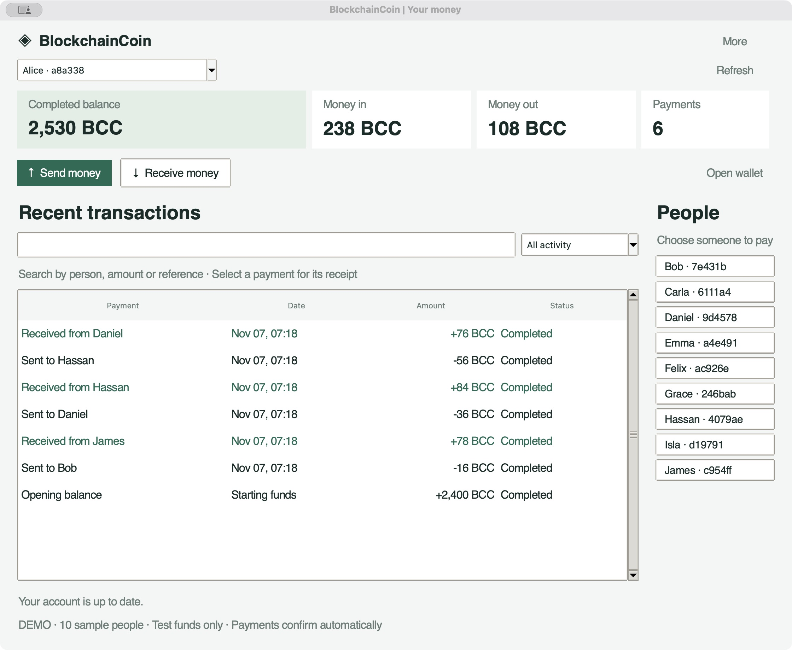
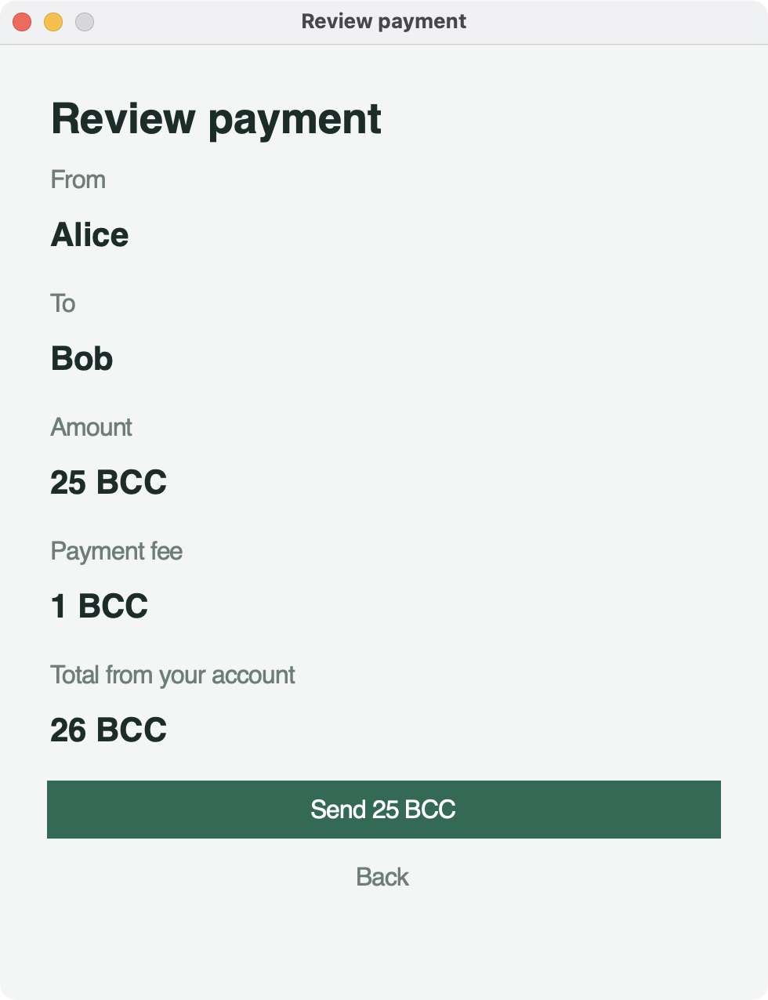
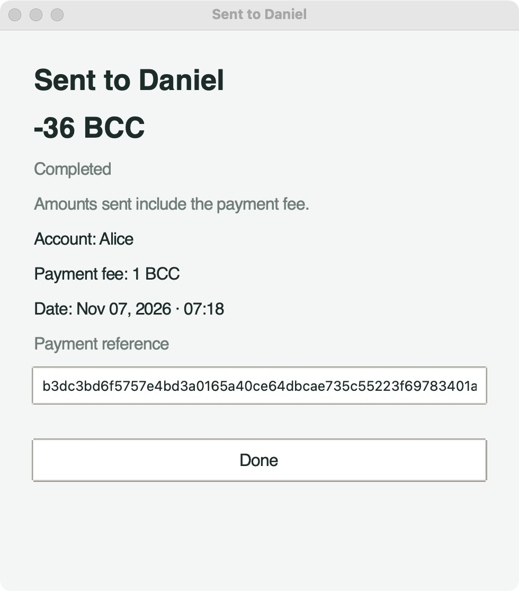

# Desktop payment demo

The native Python/Tk app treats BlockchainCoin as an account and payments app.
Recent transactions occupy the main area; balances and payment totals stay in a
compact row. People can pay a named recipient, review the fee and total, receive
with a copyable address, search and filter their history, and open receipts.

## Screenshots

Captured from the running macOS desktop app on November 7, 2026. All accounts,
funds and payment references shown here are disposable synthetic examples.



| Review before sending | Completed payment receipt |
| --- | --- |
|  |  |

The review image shows an additional, unsubmitted example. The dashboard and
receipt are from the completed 30-payment workload.

## Ten-person simulation

This is a functional simulation using ten independent wallet keys on one local
node. It is not human usability research, a throughput benchmark, or a ten-peer
network test. Each payment uses the existing signing, admission, mining,
validation and SQLite persistence code. No simulated balance is painted into the
interface independently of the ledger.

The workload sends from every person to a different person in each of three
rounds. All payments carry a 1 BCC fee. Confirmation rewards go to a separate
internal wallet so they do not inflate any person's spending summary.

| Result | Observed |
| --- | ---: |
| Synthetic people | 10 |
| Completed payments | 30 |
| Payment volume | 1,995 BCC |
| Fees | 30 BCC |
| Initial user allocations | 12,200 BCC |
| Final user balances | 12,170 BCC |
| Confirmation wallet: rewards + fees | 1,530 BCC |
| Total supply after confirmation | 13,700 BCC |
| Pending payments | 0 |

All ten closing balances matched an independent running total. An attempted
1,000,000 BCC overspend was rejected without changing the tip. Reopening the
SQLite node preserved all balances and the selected tip. The public
[machine-readable result](demo-simulation.json) contains no wallet keys.

## Reproduce

Install the package with its development dependencies using an interpreter that
supports Tk, then launch:

```sh
python -m blockchaincoin.gui
```

Every launch without `--db` creates fresh disposable wallets, allocations and the
same payment workload. Names, amounts, balances and topology repeat; generated
keys, addresses, timestamps and transaction references change. Closing removes
the demo database. With `--db`, the app uses the existing chain without seeding
sample accounts or automatically confirming payments.

Run the simulation regression, including persisted reopen checks:

```sh
python -m unittest tests.test_gui.DesktopSessionTests.test_ten_person_scenario_reconciles_and_survives_restart
```

The desktop interaction tests also exercise sending, review, receiving, account
switching, pending payments, payee shortcuts, search, filters, summaries, wallet
imports and error handling. The complete local suite passed 133 tests with 100%
line and branch coverage. Linux CI runs Tk tests under Xvfb.
